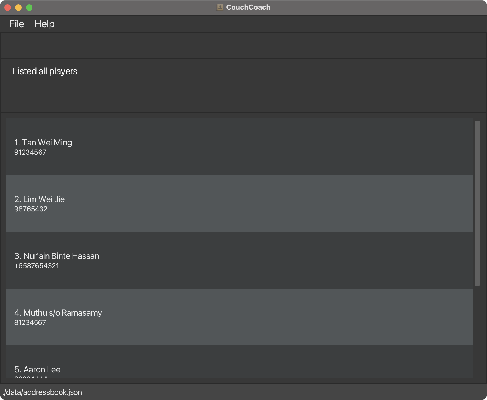

# CouchCoach User Guide

CouchCoach is a **desktop app for coaches of any sports team to keep track of their players, optimized for use through a Command Line Interface (CLI)** while retaining the benefits of a Graphical User Interface (GUI). If you type quickly, CouchCoach lets you add, find and remove players faster than a clipboard, a spreadsheet or a typical mouse-driven app.

<!-- * Table of Contents -->
<page-nav-print />

--------------------------------------------------------------------------------------------------------------------

## Quick start

1. Ensure that Java `25` or later is installed on your computer.<br>
   **Mac users:** Ensure you have the precise JDK version prescribed [here](https://se-education.org/guides/tutorials/javaInstallationMac.html).

1. Download the latest `couchcoach.jar` file from [here](https://github.com/AY2627S1-CS2103T-W13-1/tp/releases).

1. Copy the file to the folder you want to use as the _home folder_ for CouchCoach.

1. Open a terminal, `cd` to the folder containing the JAR file, and run `java -jar couchcoach.jar`.<br>
   A window like the one below should appear in a few seconds. The first time you run it, CouchCoach contains some sample players.<br>
   

1. Type a command in the command box and press Enter to execute it. For example, type **`help`** and press Enter to see a summary of all commands.<br>
   Some example commands you can try:

   * `list` : Lists all players.

   * `add n/Tan Wei Ming p/91234567` : Adds a player named `Tan Wei Ming` to the team.

   * `delete 3` : Deletes the 3rd player shown in the current list.

   * `clear` : Deletes all players.

   * `exit` : Exits the app.

1. Refer to the [Features](#features) section below for details of each command.

--------------------------------------------------------------------------------------------------------------------

## Features

<box type="info" seamless>

**Notes about the command format:**<br>

* Words in `UPPER_CASE` are the parameters to be supplied by the user.<br>
  For example, in `add n/NAME`, replace `NAME` with a value such as `John Doe`.

* Items in square brackets are optional.<br>
  For example, `edit INDEX [n/NAME] [p/PHONE]` can be used as `edit 1 n/Tan Wei Ming` or as `edit 1 p/91234567`.

* Items followed by `...` can appear zero or more times.<br>
  For example, `find KEYWORD [MORE_KEYWORDS]...` can be used as `find wei` or as `find wei ming`.

* Parameters can be in any order.<br>
  For example, if the command specifies `n/NAME p/PHONE`, `p/PHONE n/NAME` is also acceptable.

* Extraneous parameters for commands that take no parameters, such as `help`, `list`, `exit`, and `clear`, are ignored.<br>
  For example, `help 123` is interpreted as `help`.

* If you are using a PDF version of this document, be careful when copying and pasting commands that span multiple lines as space characters surrounding line-breaks may be omitted when copied over to the application.
</box>

### Viewing help: `help`

Shows a summary of every command, with examples, in place of the player list.

Format: `help`

* You can also open the summary from the `Help` menu or by pressing `F1`.
* Type `list` to see your players again. Any successful player command also brings the list back.
* While the summary is shown, an index such as the `1` in `delete 1` still refers to the player list that was displayed before you opened help.
* If you type a command CouchCoach does not recognise, or press Enter on an empty command box, the result box shows `Unknown command. Type 'help' to see the list of commands.`


### Adding a player: `add`

Adds a player to the team.

Format: `add n/NAME p/PHONE [j/JERSEY]`

* Both `NAME` and `PHONE` must be given, in any order. `JERSEY` is optional.
* `NAME` can contain only letters, digits, spaces, and the characters `-` `'` `/` `.`, and can be at most 100 characters long.
* `NAME` is saved with the capitalisation you type. Extra spaces at the start and end are removed, and repeated spaces inside the name are reduced to one.
* `PHONE` must have 3 to 15 digits and may start with a single `+`. Spaces and hyphens are allowed, and are removed before saving, e.g. `8123 4567` is saved as `81234567`.
* `JERSEY` must be a whole number from 0 to 99. A leading zero is dropped, e.g. `j/07` is saved as `7`.
* A player cannot be added if a player with the same name is already in the team. Names are compared ignoring capitalisation and repeated spaces, so `tan wei ming` counts as the same player as `Tan Wei Ming`. Phone numbers are not compared, so two players may share a contact number.
* Players may share a jersey number, but the result box then warns you and names the other players with that number, e.g. `Warning: jersey number 7 is also used by Bernice Yu.` The player is still added.
* If a parameter is given more than once, only the last one is used, e.g. `add n/Amy n/Bob p/91234567` adds `Bob`.
* The new player appears at the bottom of the list. If the list was filtered by `find`, the full list is shown again.

<box type="tip" seamless>

**Tip:** To add two players with the same name, add something to tell them apart, e.g. `n/Tan Wei Ming 2` or `n/Tan Wei Ming Jr`.
</box>

Examples:
* `add n/Tan Wei Ming p/91234567`
* `add n/Lim Wei Jie p/98765432 j/10`
* `add p/+6598765432 n/Nur'ain Binte Hassan`
* `add n/Muthu s/o Ramasamy p/8123 4567`

### Listing all players: `list`

Shows every player and clears any filter from a previous `find` command.

Format: `list`

Players appear in the order they were added, numbered from 1. The result box shows
`Listed all players`, even when the team is empty. This command does not change player data.
Any text after `list` is ignored, so `list all` has the same effect as `list`.

Indices refer to positions in the currently displayed list and can change after deletion.
Run `list` again before using an index if you need to see the full team.

### Editing a player: `edit`

Edits an existing player in the team.

Format: `edit INDEX [n/NAME] [p/PHONE] [j/JERSEY]`

* Edits the player at the specified `INDEX`. The index refers to the index number shown in the displayed player list. The index **must be a positive whole number** 1, 2, 3, ...
* At least one of the optional fields must be provided.
* Existing values will be updated to the input values. Names, phone numbers and jersey numbers follow the same rules as in `add`.
* To remove a player's jersey number, type `j/` with nothing after it.
* If the new jersey number is already used by another player, the change is still made and the result box shows the same warning as in `add`.
* Each parameter can be given only once, e.g. `edit 1 n/Amy n/Bob` is rejected.

Examples:
*  `edit 1 p/91234567` Edits the phone number of the 1st player to be `91234567`.
*  `edit 2 n/Lim Wei Jie` Edits the name of the 2nd player to be `Lim Wei Jie`.
*  `edit 3 j/23` Sets the jersey number of the 3rd player to be `23`.
*  `edit 3 j/` Removes the jersey number of the 3rd player.

### Finding players by name: `find`

Filters the displayed list to players whose names match any of the given keywords.

Format: `find KEYWORD [MORE_KEYWORDS]...`

* Supply at least one keyword. Separate keywords with spaces; repeated spaces are accepted.
* The search is case-insensitive: `find wei` matches `Tan Wei Ming`.
* Only whole words match: `find Wei` matches `Tan Wei Ming`, while `find We` does not.
* Only names are searched. A phone number matches only if it is also a whole word in a player's name.
* A player matching **any** keyword is shown (an `OR` search). Keyword order does not matter.
* Each matching player appears once, even when several keywords match or a keyword is repeated.
* Slashes and other allowed name punctuation are part of a word: `find s/o` matches
  `Muthu s/o Ramasamy`. No tagged parameters are used; `find n/Wei` searches for the literal word `n/Wei`.
* Each search searches the whole team, including players hidden by an earlier search.
* Results keep their order in the full list and are numbered from 1. After `find`, `delete 1`
  deletes the first displayed match. The search filter remains active after deletion.
* Use `list` to restore the full team list.
* Searching changes neither player records nor the saved data file.

For a team containing `Tan Wei Ming`, `Lim Wei Jie`, `Nur Aisyah`, and `Muthu s/o Ramasamy`:

| Command | Displayed players | Result message |
| --- | --- | --- |
| `find wei` | Tan Wei Ming, Lim Wei Jie | `2 players listed!` |
| `find TAN` | Tan Wei Ming | `1 player listed!` |
| `find wei nur` | Tan Wei Ming, Lim Wei Jie, Nur Aisyah | `3 players listed!` |
| `find ming tan ming` | Tan Wei Ming, once | `1 player listed!` |
| `find We` | Empty list | `0 players listed!` |
| `find s/o` | Muthu s/o Ramasamy | `1 player listed!` |

Entering `find` without keywords, including `find` followed only by spaces, shows:

```text
Invalid command format!
find: Finds players whose names contain any of the given keywords.
Parameters: KEYWORD [MORE_KEYWORDS]...
Example: find wei ming
```

The displayed list and player data remain unchanged after this error. Command words are
case-sensitive: use `find`, as `Find` is unrecognized.

### Deleting a player: `delete`

Deletes the specified player from the team.

Format: `delete INDEX`

* Deletes the player at the specified `INDEX`.
* The index refers to the index number shown in the displayed player list, which may be filtered by `find`.
* The index **must be a positive whole number** 1, 2, 3, ...
* The remaining players are renumbered after a deletion, so check the list again before deleting another player.

Examples:
* `list` followed by `delete 2` deletes the 2nd player in the team.
* `find Tan` followed by `delete 1` deletes the 1st player in the results of the `find` command.

### Clearing all players: `clear`

Deletes all players from the team.

Format: `clear`

<box type="warning" seamless>

**Caution:** `clear` cannot be undone and does not ask for confirmation.
</box>

### Exiting the program: `exit`

Closes CouchCoach. Every change that was saved successfully is kept. `exit` does not save, so if a change could not be saved, save it before exiting (see [Saving the data](#saving-the-data)); otherwise that change is lost.

Format: `exit`

### Saving the data

CouchCoach saves your data automatically after every change (`add`, `edit`, `delete` and `clear`). You do not need to save manually. `list`, `find`, `help` and `exit` do not change your data, so they do not save.

If a change cannot be saved (e.g. the data folder was deleted or made read-only), the result box shows `Your change was applied but could not be saved to disk. Fix the problem before closing CouchCoach, or the change will be lost.` The change is still shown in CouchCoach, but it is not on disk yet.

Fixing the problem does not save the change by itself, and `exit` does not save either. To save it:

1. Fix the problem, e.g. restore the data folder or make it writable again.
1. Make another change. Every save writes your whole team, so the next successful change also saves the change that failed earlier. If you have nothing else to change, add a temporary player and then delete it, e.g. `add n/Temp Player p/000` followed by `delete INDEX`, using the temporary player's index.
1. Check that the result box shows the normal success message, not the save error, before you exit.

### Editing the data file

CouchCoach data is saved automatically as a JSON file `[JAR file location]/data/addressbook.json`. Advanced users are welcome to update data directly by editing that data file.

<box type="warning" seamless>

**Caution:**
If your changes make the data file invalid, CouchCoach starts with an empty team at the next run and shows a warning in the result box. The invalid file stays on disk until your next change (`add`, `edit`, `delete` or `clear`), which replaces it, so back up the file before editing it.<br>
A file containing two players with the same name, ignoring capitalisation and repeated spaces, also counts as invalid.<br>
Furthermore, certain edits can cause CouchCoach to behave in unexpected ways (e.g., if a value entered is outside of the acceptable range). Therefore, edit the data file only if you are confident that you can update it correctly.
</box>

--------------------------------------------------------------------------------------------------------------------

## FAQ

**Q**: How do I transfer my data to another computer?<br>
**A**: Install the app on the other computer and overwrite the data file it creates with the data file from your previous CouchCoach home folder.

--------------------------------------------------------------------------------------------------------------------

## Known issues

1. **When using multiple screens**, if you move the application to a secondary screen, and later switch to using only the primary screen, the GUI will open off-screen. The remedy is to delete the `preferences.json` file created by the application before running the application again.

--------------------------------------------------------------------------------------------------------------------

## Command summary

Action     | Format, Examples
-----------|----------------------------------------------------------------------------------------------------------------------------------------------------------------------
**Add**    | `add n/NAME p/PHONE [j/JERSEY]` <br> e.g., `add n/Tan Wei Ming p/91234567 j/10`
**Clear**  | `clear`
**Delete** | `delete INDEX`<br> e.g., `delete 3`
**Edit**   | `edit INDEX [n/NAME] [p/PHONE] [j/JERSEY]`<br> e.g., `edit 2 n/Lim Wei Jie`, `edit 3 j/23`
**Exit**   | `exit`
**Find**   | `find KEYWORD [MORE_KEYWORDS]...`<br> e.g., `find wei ming`
**List**   | `list`
**Help**   | `help`
